<div align="center">


# 学业管家 · Integrated Study Planner

**课表 · 待办 · 专注 · 成长 一体化的大学生学习规划系统**

网页版 · Windows 客户端 · Android 客户端　|　域名：`xueyeguanjia.com`

[中文](#中文) · [English](#english)

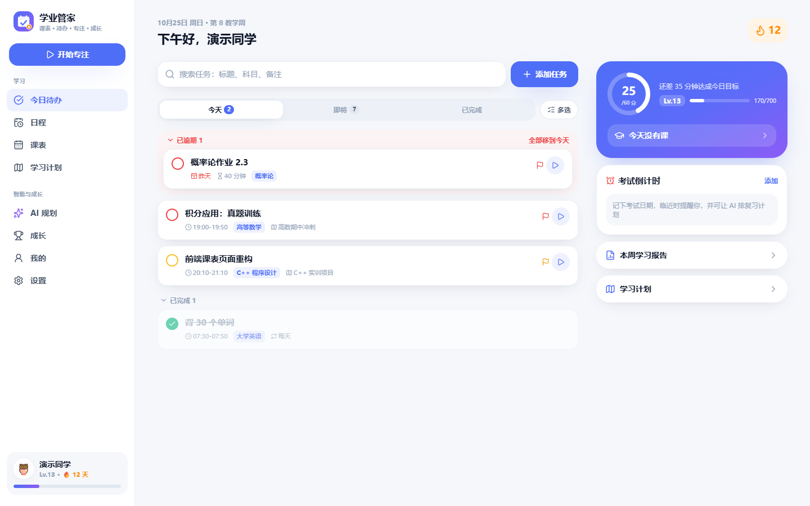

</div>

---

<a id="中文"></a>

## 中文

### 项目简介

学业管家是面向大学生的学习规划系统。它以课表为基础，把课程安排、学习任务、专注计时、学习激励与 AI 规划统一在同一个账号和同一份数据中：课表决定可用时间，AI 在空闲时段内安排学习任务，专注时长记录到具体任务上，完成情况实时转化为经验值、等级与连续学习天数。

### 现有应用的局限

| 应用类型 | 常见局限 |
|---|---|
| 课程表类应用 | 只记录上课时间，不知道课余时间用来做什么；无法把复习计划与课表关联 |
| 通用待办清单 | 不了解课程安排，任务时间需要手动避开上课时段；缺少面向学习的统计与反馈 |
| 学习打卡、激励类应用 | 激励与真实学习任务脱节，打卡数据无法反映课程与计划的完成情况 |
| AI 对话助手 | 不了解个人课表与已有安排，给出的计划无法直接执行，需要手动誊抄 |

学生通常需要在多个应用之间来回切换、重复录入，数据彼此割裂。

### 学业管家的完整功能

**课表管理**
- 节次网格课表，按教学周切换，支持单双周与不连续周（如 `1-3周,18周`）
- 课程时间冲突检测，自定义开学日期、总周数与每节课时间
- 三种导入方式：教务系统网页（正方、强智、青果等常见格式）、Excel 课表文件、图片或 PDF 经大模型识别
- 课前 10 分钟提醒
- 课表导出为图片；生成分享码，同学输入后即可导入同一份课表
- 考试倒计时：记录考试日期，临近时提醒，并可由 AI 按剩余天数排出复习计划

**任务与日程**
- 今天、即将、已完成三种任务视图，逾期任务一键移到今天
- 四级优先级、重复任务（每天、工作日、每周）、未定时间的全天任务
- 标签、清单分组、子任务清单与单独的提醒时间；备注中的网址可直接点击打开
- 按标题、科目、备注搜索全部任务；多选后批量删除或修改日期
- 日、周、月三种日程视图，课程与任务按时间顺序统一展示；周视图与月视图中可拖动任务改期

**专注计时**
- 番茄钟可关联具体任务，预设时长与自定义时长（1–180 分钟）
- 基于时间戳计时，切换页面、锁屏或刷新不影响准确性；提前结束按实际分钟记录
- 白噪音、粉红噪音、棕噪音与雨声；记录专注期间切出页面的次数；同一账号在多台设备间同步进行中的专注

**成长激励**
- 经验值与等级、连续学习天数及断签提醒、每日专注目标
- 断签保护卡：连续学习每满 7 天获得 1 张，漏学一天时自动补上
- 15 项成就、本周经验值排行榜、学习热力图、近 7 天与近 30 天统计、科目时长分布
- 每周学习报告：专注、任务与科目数据及与上周的对比，并附 AI 复盘建议
- 学习小组：通过邀请码加入，查看组内本周学习情况
- 奖励按"用户、原因、对象"唯一记账，重复操作不会重复计分，撤销完成会相应扣回

**AI 学习助手**
- 以对话方式工作：先读取课表、已有任务与空闲时段，信息不足时主动追问，再给出方案
- 可新建学习任务、添加课程，或修改已有任务与课程的时间；所有改动先以卡片形式展示，确认后才写入
- 导入前可逐项修改日期与时间；逐条导入，失败的条目单独说明原因（如与课程时间冲突）
- 可联网搜索 B 站等平台的课程视频，链接写入任务备注
- 上传讲义或 PDF 生成章节大纲，并据此排出复习计划
- 保存多个对话，可随时切换与继续；无模型时由本地规则引擎完成规划
- 支持任何 OpenAI 兼容模型（DeepSeek、通义千问、Kimi、智谱、Ollama 等），密钥加密保存；可选择思考深度
- 按学习时段偏好排程：根据近 60 天专注记录自动判断，也可自定义优先时段、避开时段与单次时长

**学习计划**
- 手动创建或由 AI 生成，显示进度与专注时长
- 进行中、已完成、已归档三种状态；删除的计划进入回收站，30 天内可恢复，支持多选恢复、彻底删除与一键清空

**账号与安全**
- 邮箱注册登录、演示账号；邮箱验证码验证与找回密码
- 绑定邮箱与手机号、修改密码、退出其他设备
- 连续输错密码 5 次锁定 10 分钟；修改密码后其他设备上的登录立即失效
- 导出全部个人数据、注销账号

**问题反馈与管理后台**
- 用户在设置中提交反馈，可查看处理进度与管理员回复
- 管理员看板：用户与活跃统计、反馈处理、前端错误记录；仅指定的管理员账号可以进入

**个性化与多端**
- 七种主题：默认、深色、跟随系统，以及晨光杏桃、雾松青、夜读靛、赤陶纸四种玻璃质感主题；主题随账号同步
- 降低透明度与增强对比度两项无障碍选项
- 手机、平板、电脑自适应布局；电脑端为侧边栏与多栏布局，支持键盘快捷键与作为独立窗口安装（PWA）
- 断网时显示提示，已加载的页面仍可查看
- Windows 客户端与 Android 客户端，与网页版连接同一服务器，账号数据实时一致；客户端内可切换服务器地址

### 功能截图

| 课表 | 周视图 |
|---|---|
| 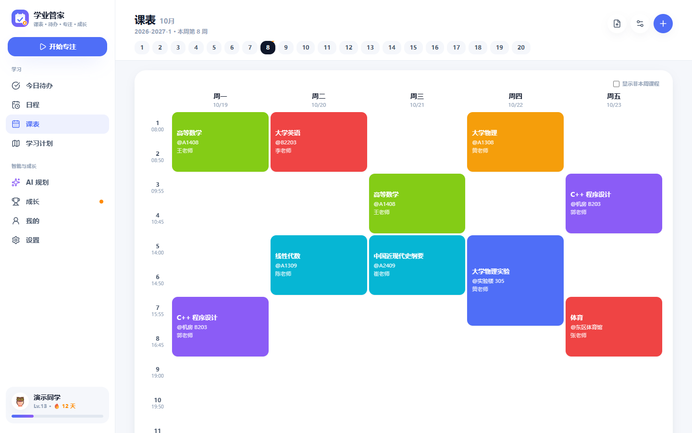 | 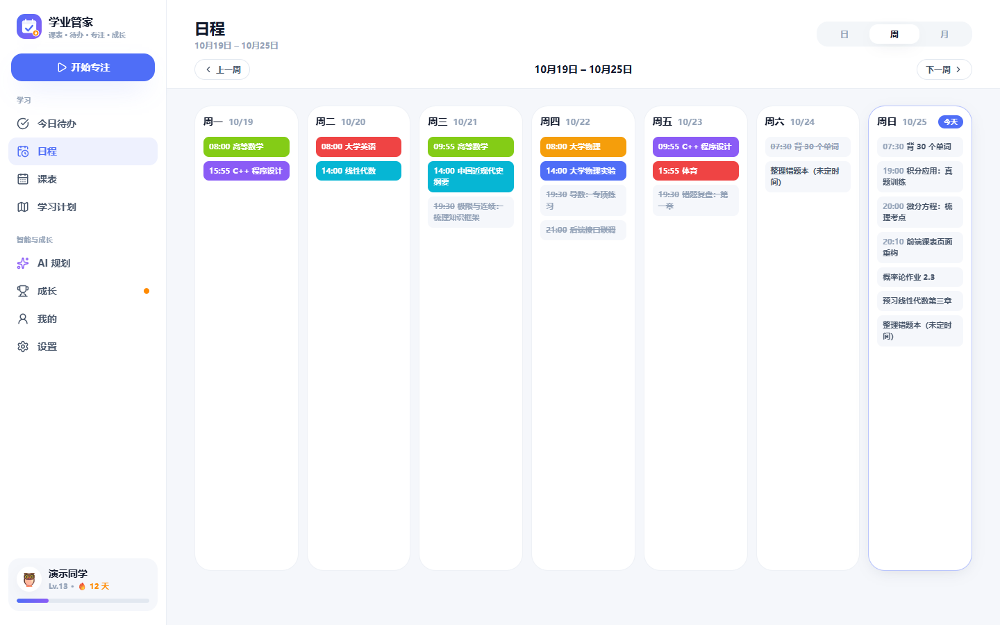 |
| **AI 学习规划** | **从教务系统网页导入课表** |
| 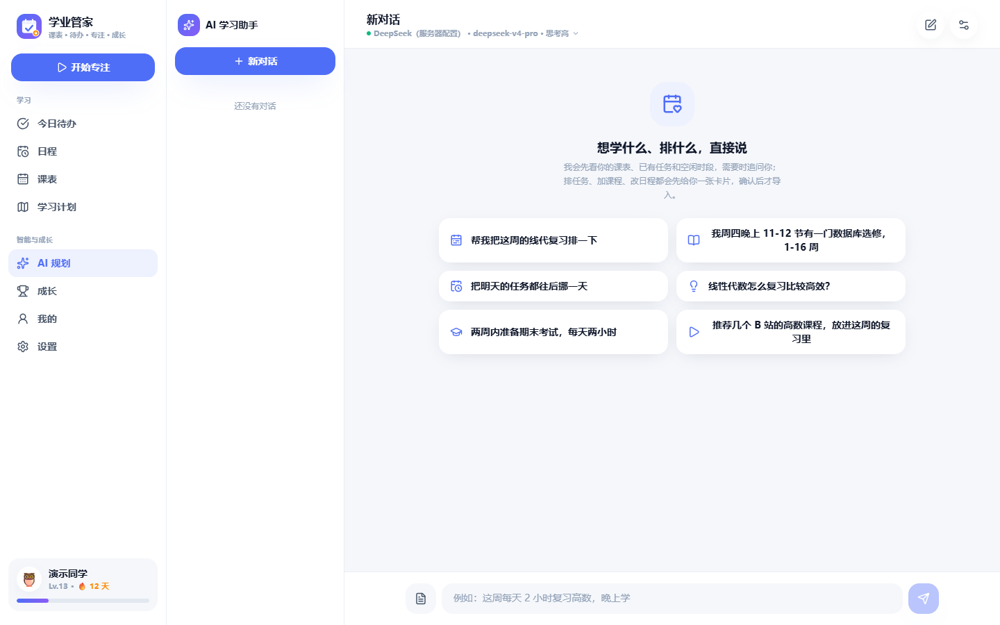 | 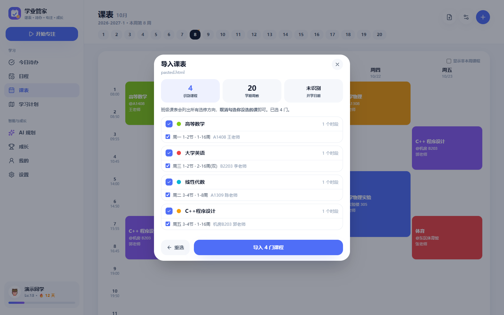 |
| **成长统计** | **设置** |
| 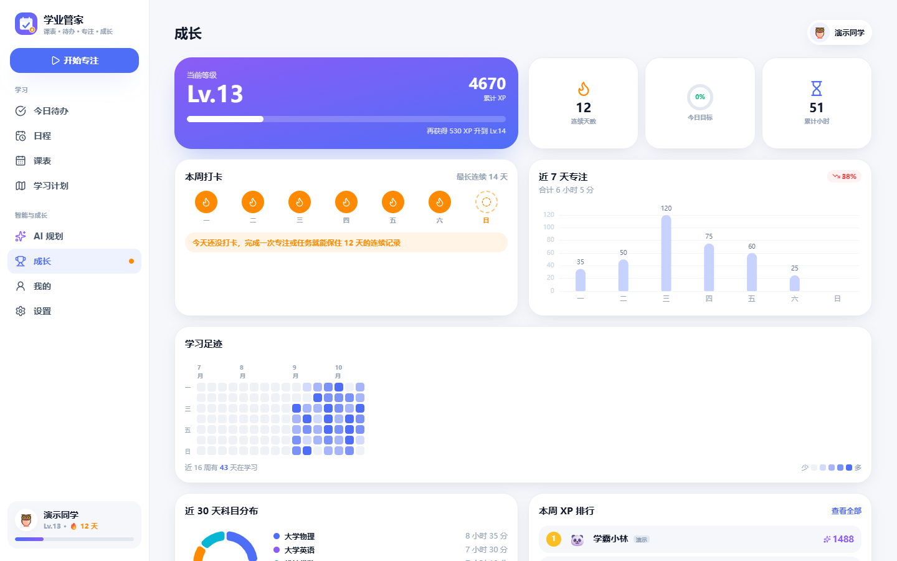 | 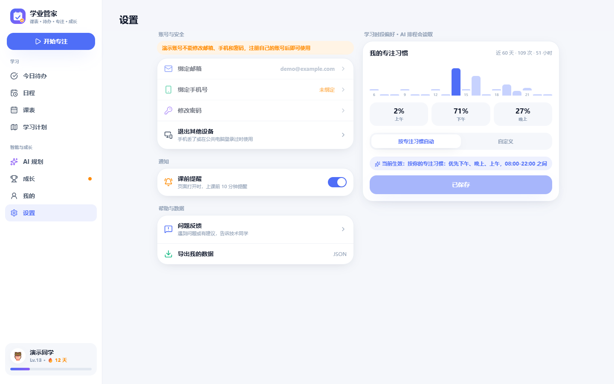 |

**主题**

| 晨光杏桃 | 雾松青 |
|---|---|
| 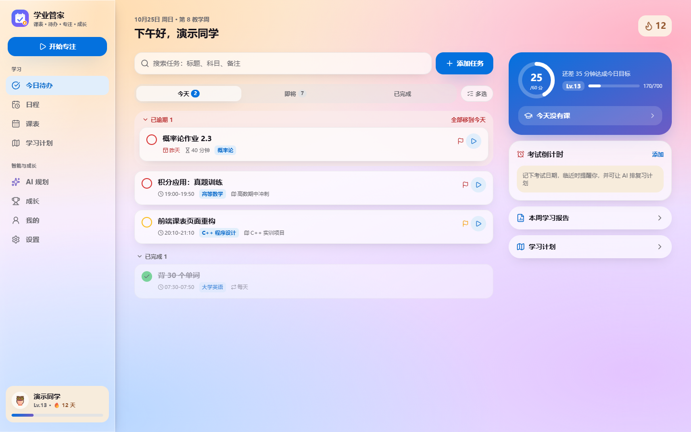 | 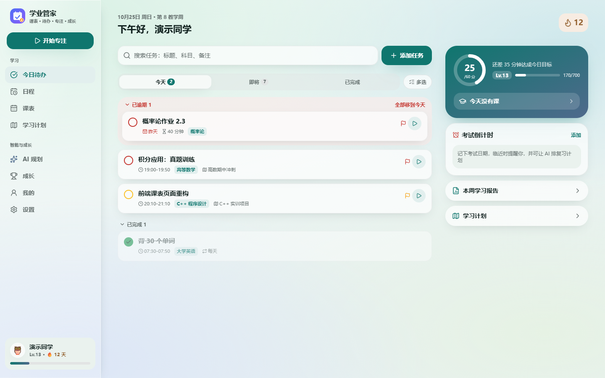 |
| **夜读靛** | **赤陶纸** |
| 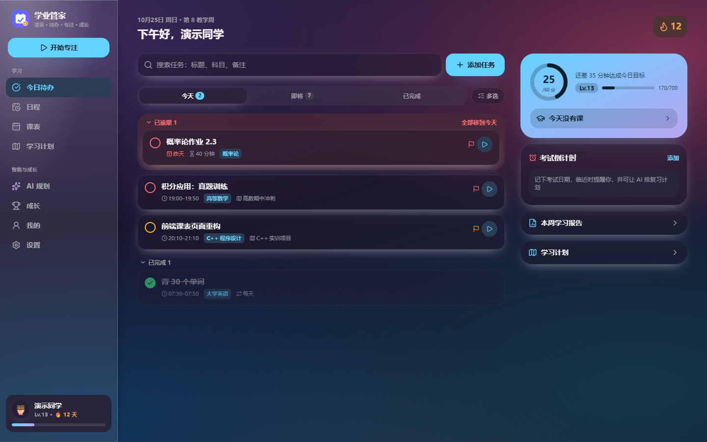 | 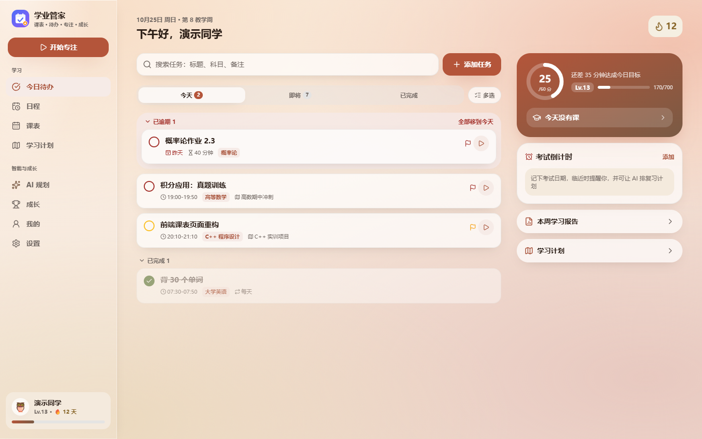 |

<details>
<summary>手机端截图</summary>

| 今日 | 课表 | 日程 | 专注 | 成长 | AI |
|---|---|---|---|---|---|
| 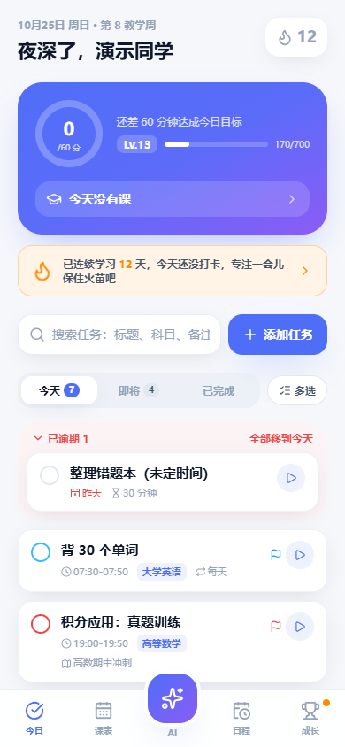 | 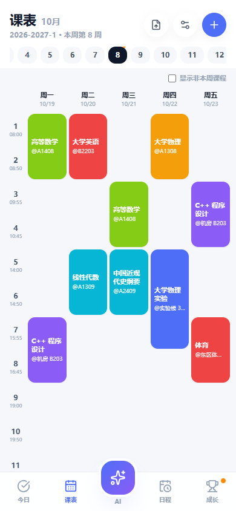 | 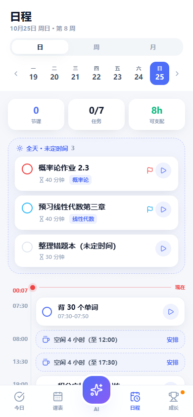 | 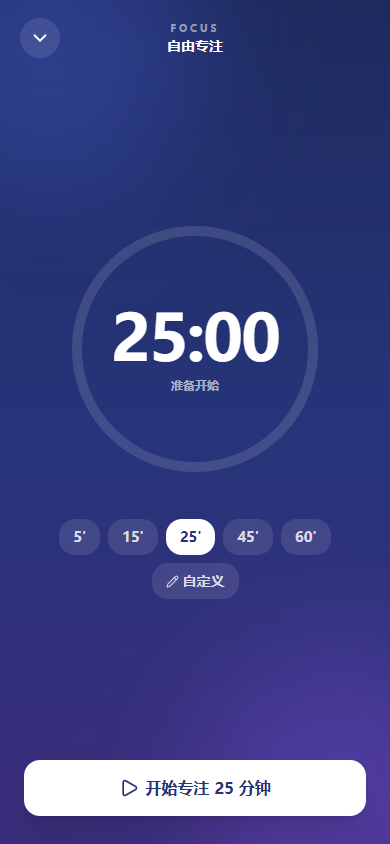 | 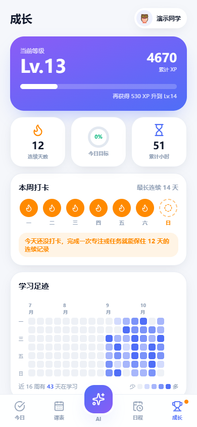 |  |

</details>

### 版本迭代

**v1.0 · 基础模块**
- 后端 FastAPI 框架与 SQLite 数据库设计
- 教务 Excel 课表解析、PDF 章节提取与导入接口
- 学习任务与学习计划的基础接口
- 接入 DeepSeek 生成学习计划
- Vue 3 前端页面框架

**v2.0 · 系统重构与联动**
- 统一接口协议 `{code, message, data}`，JWT 鉴权与用户数据隔离，前后端接口契约测试
- 课表支持教学周、单双周、冲突检测，自动识别开学日期与总周数
- 任务视图、优先级、重复任务、自然语言快速添加
- 番茄钟专注计时，专注时长记录到任务
- 经验值、等级、连续打卡、成就、排行榜与学习热力图
- AI 规划改为读取课表、按空闲时段排程，先生成草稿、确认后导入；无模型时使用规则引擎
- 日、周、月日程视图；旧数据库启动时自动升级

**v3.0 · 智能化与多端**
- AI 支持自定义 OpenAI 兼容模型；回复分为学习建议与结构化计划，可按天导入；10 轮对话记忆与日期范围识别
- 课表新增教务系统网页导入与图片、PDF 的 AI 识别导入
- 学习时段偏好设置，AI 排程优先安排习惯时段
- 设置页：绑定邮箱与手机号、修改密码、退出其他设备、数据导出、注销账号、问题反馈
- 任务搜索与批量操作；学习计划回收站与归档
- 登录失败锁定、修改密码后旧凭证失效
- 电脑端多栏布局与 PWA 安装；Windows 与 Android 客户端

**v4.0 · AI 助手与体验完善**
- AI 改为对话式助手：读取课表与任务后再回答，信息不足时追问；可新建任务、添加课程、修改已有安排，改动确认后写入
- AI 方案导入前可逐项改时间，逐条导入并说明失败原因；联网搜索课程视频；讲义生成大纲与复习计划；多对话保存
- 任务标签、清单、子任务与提醒时间；周视图与月视图拖动改期
- 考试倒计时、课表导出图片与分享码导入
- 白噪音、切出次数统计、多设备专注同步；断签保护卡、科目分布、每周学习报告、学习小组
- 邮箱验证码与找回密码；反馈处理进度与管理员回复；管理员看板与前端错误记录
- 七种主题与无障碍选项、键盘快捷键、断网提示；端到端测试

### 本地运行

环境要求：Python 3.11 及以上，Node.js 20 及以上，Git。

#### Windows 一键下载与配置（PowerShell）

以下命令在 Windows PowerShell 中逐段复制执行，即可从零下载代码、安装依赖并启动。

**1. 安装环境**（已安装可跳过；装完后关闭并重新打开 PowerShell，使新命令生效）

```powershell
winget install --id Git.Git -e
winget install --id Python.Python.3.12 -e
winget install --id OpenJS.NodeJS.LTS -e
```

**2. 下载代码**（默认放在 `D:\xueyeguanjia`，可自行修改路径）

```powershell
git clone https://github.com/TLOMMY/Integrated_study_planner.git D:\xueyeguanjia
cd D:\xueyeguanjia
```

无法访问 GitHub 时，可在仓库页面点击 Code → Download ZIP，解压后在解压目录中打开 PowerShell，从第 3 步继续。

**3. 安装依赖**（只需执行一次）

```powershell
python -m venv "Backend+AI-interface\.venv"
& "Backend+AI-interface\.venv\Scripts\python.exe" -m pip install -r "Backend+AI-interface\requirements.txt"
npm install --prefix Frontend
```

下载缓慢时，可在 pip 命令末尾加上 `-i https://pypi.tuna.tsinghua.edu.cn/simple`，在 npm 命令末尾加上 `--registry=https://registry.npmmirror.com`。

**4. 启动**（每次使用时在项目目录执行，会打开两个窗口分别运行后端与前端）

```powershell
$root = (Get-Location).Path
Start-Process powershell -WorkingDirectory "$root\Backend+AI-interface" -ArgumentList '-NoExit', '-Command', '.\.venv\Scripts\python.exe -m uvicorn main:app --reload'
Start-Process powershell -WorkingDirectory "$root\Frontend" -ArgumentList '-NoExit', '-Command', 'npm run dev'
Start-Sleep 6; Start-Process http://localhost:5173
```

浏览器会自动打开 <http://localhost:5173>。关闭这两个窗口即停止运行。

**更新到最新版本**：在项目目录执行 `git pull`，再重新执行第 3 步与第 4 步。

**用手机访问电脑上运行的版本**：手机与电脑连接同一 Wi‑Fi，把第 4 步中的 `npm run dev` 改为 `npm run dev -- --host`，然后在手机浏览器打开 `http://电脑的IP:5173`（电脑 IP 可用 `ipconfig` 查看 IPv4 地址）。Windows 与 Android 客户端可在登录页的服务器设置中填写同一地址。

#### 手动启动（macOS / Linux 或已有环境）

```bash
# 后端：http://127.0.0.1:8000，接口文档 http://127.0.0.1:8000/docs
cd Backend+AI-interface
python -m venv .venv
.venv\Scripts\activate            # macOS / Linux：source .venv/bin/activate
pip install -r requirements.txt
python -m uvicorn main:app --reload

# 前端：http://localhost:5173（/api 自动转发到后端）
cd Frontend
npm install
npm run dev
```

打开 <http://localhost:5173>，点击「一键体验演示账号」即可查看预置的课表、计划、学习记录与排行榜（`demo@example.com` / `demo123456`）。

如需使用大模型，在 `Backend+AI-interface/.env` 中配置 `DEEPSEEK_API_KEY`（配置项参考 `deploy/backend.env.example`），或登录后在「AI 规划 → 设置」中添加模型。未配置时由本地规则引擎完成规划。

### 打包客户端

```bash
# Windows：在 desktop/dist/ 生成安装版与免安装版 exe
cd desktop
npm install
npm run dist

# Android：需要 JDK 21 与 Android SDK（platform 36、build-tools 36）
cd Frontend
npm run build
npx cap sync android
cd android
gradlew assembleRelease
```

### 项目结构

```
Backend+AI-interface/   后端：FastAPI + SQLAlchemy 2 + SQLite
  app/api/routes/       认证、用户、任务、课表、导入、专注统计、学习计划与 AI、模型设置、反馈
  app/services/         课表与周次、课表解析、任务、成长激励、日程聚合、学习偏好
  app/ai/               AI 助手（对话、工具调用、方案校验）、空闲时段排程、模型客户端、联网搜索、图片与 PDF 识别
  tests/                后端测试
Frontend/               前端：Vue 3 + Vite + Pinia + Tailwind CSS
  src/themes/           主题配色
  android/              Android 客户端工程（Capacitor）
desktop/                Windows 客户端（Electron）
e2e/                    端到端测试（电脑与手机尺寸）
deploy/                 服务器配置文件
docs/                   功能截图与数据库设计文档
data-import/            课表解析原型与示例课表
```

### 测试

```bash
cd Backend+AI-interface && python -m pytest     # 后端 174 个用例，使用临时数据库，不访问外网
cd Frontend && npm test                          # 前端 16 个单元测试
cd Frontend && npm run build                     # 生产构建
cd e2e && npm install && npm test                # 端到端测试，使用本机 Edge 浏览器
```

后端测试覆盖认证与数据隔离、课表与导入、任务、成长激励、AI 助手与模型接入、账号安全、反馈与管理后台、回收站与批量操作，并包含前后端接口契约测试：前端调用的每一个接口都必须在后端存在，否则测试失败。端到端测试在电脑与手机两种尺寸下走通登录、任务、专注、日程切换、主题切换与断网提示等核心流程。

### 路线图

| 版本 | 状态 | 内容 |
|---|---|---|
| v1.0 | ✅ 已完成 | 基础模块：后端框架、课表解析、任务与计划接口、DeepSeek 接入、前端框架 |
| v2.0 | ✅ 已完成 | 系统重构：统一协议与鉴权、课表周次、任务体系、专注计时、成长激励、空闲时段排程 |
| v3.0 | ✅ 已完成 | 智能化与多端：多模型 AI、多种课表导入、学习偏好、账号安全、Windows 与 Android 客户端 |
| v4.0 | ✅ 已完成 | AI 助手与体验完善：对话式 AI 助手、任务与课表增强、专注与成长扩展、反馈与管理后台、多主题 |

### AI 贡献

Claude 参与了前端的设计与美化。

### 团队

璞玉计划项目小组

---

<a id="english"></a>

## English

### Overview

XueYeGuanJia is a study planning system for university students. Built around the class timetable, it brings courses, study tasks, focus sessions, motivation and AI planning into a single account and a single data set: the timetable defines available time, the AI schedules study tasks into free slots, focus time is recorded against specific tasks, and progress is converted into experience points, levels and study streaks in real time.

### Limitations of existing apps

| App category | Common limitations |
|---|---|
| Timetable apps | Record class times only; no link between free time and revision plans |
| General to-do lists | Unaware of the class schedule, so tasks must be manually kept clear of lectures; no study-oriented statistics |
| Habit and motivation apps | Rewards are detached from real study tasks; streaks do not reflect course or plan progress |
| AI chat assistants | Do not know the user's timetable or existing commitments; plans cannot be executed directly and must be copied by hand |

Students typically switch between several apps, re-enter the same information and end up with fragmented data.

### Features

**Timetable**
- Period-grid timetable by teaching week, with odd/even and non-contiguous weeks (e.g. `1-3, 18`)
- Conflict detection; configurable semester start, number of weeks and period times
- Three import methods: the school's academic-affairs web pages (ZhengFang, QiangZhi, QingGuo and similar), Excel files, and images or PDFs recognised by a large language model
- Reminders 10 minutes before class
- Export the timetable as an image; share it with a code that classmates can enter to import the same timetable
- Exam countdown: record exam dates, get reminders as they approach, and let the AI build a revision plan for the days left

**Tasks and calendar**
- Today, Upcoming and Completed views; move overdue tasks to today in one step
- Four priority levels, repeating tasks (daily, weekdays, weekly) and all-day tasks without a fixed time
- Tags, lists, checklists and per-task reminder times; web links in notes open with a click
- Search across titles, subjects and notes; multi-select to delete or reschedule in bulk
- Day, week and month views with courses and tasks shown together in chronological order; drag tasks to reschedule in the week and month views

**Focus timer**
- Pomodoro sessions linked to tasks, with presets and custom durations (1–180 minutes)
- Timestamp-based timing that stays accurate across page switches, screen locks and reloads; early finishes are recorded by actual minutes
- White, pink and brown noise and rain sounds; counts how often the user leaves the page during a session; an active session is synced across the user's devices

**Motivation**
- Experience points and levels, study streaks with at-risk alerts, daily focus goal
- Streak protection: one protection card for every 7 consecutive study days, used automatically when a day is missed
- 15 achievements, weekly leaderboard, study heatmap, 7-day and 30-day statistics, time by subject
- Weekly study report: focus, task and subject figures compared with the previous week, with an AI review
- Study groups: join with an invite code and see the group's study activity for the week
- Rewards are booked once per user, reason and target, so repeated actions never double-count and undoing a completion revokes its reward

**AI study assistant**
- Works as a conversation: reads the timetable, existing tasks and free slots first, asks follow-up questions when information is missing, then proposes a plan
- Creates study tasks, adds courses, or moves existing tasks and courses; every change is shown as a card and written only after confirmation
- Dates and times can be edited item by item before import; items are imported one by one, and any that fail are listed with the reason (for example, a clash with a class)
- Searches the web for course videos on Bilibili and similar platforms and adds the links to the task note
- Generates a chapter outline from uploaded handouts or PDFs and builds a revision plan from it
- Keeps multiple conversations that can be resumed at any time; a local rule engine handles planning when no model is configured
- Works with any OpenAI-compatible model (DeepSeek, Qwen, Kimi, GLM, Ollama and others) with encrypted key storage and a selectable reasoning depth
- Schedules by study-time preference, either learned from the last 60 days of focus records or set manually (preferred and avoided periods, session length)

**Study plans**
- Created manually or generated by AI, with progress and focus time
- Active, Completed and Archived states; deleted plans go to a recycle bin for 30 days, with multi-select restore, permanent deletion and empty-bin

**Account and security**
- Email sign-up and sign-in, demo account; email verification codes and password reset
- Email and phone binding, password change, sign out of other devices
- Lockout for 10 minutes after 5 failed sign-in attempts; other sessions are revoked when the password changes
- Full data export and account deletion

**Feedback and admin console**
- Users submit feedback from Settings and can follow its status and read replies from the maintainers
- Admin console with user and activity statistics, feedback handling and frontend error logs; only designated admin accounts can open it

**Personalisation and multi-platform**
- Seven themes: Default, Dark, Follow System, and four glass-style themes (Apricot Dawn, Mist Pine, Night Indigo, Terracotta Paper); the chosen theme syncs with the account
- Accessibility options to reduce transparency and increase contrast
- Responsive layout for phones, tablets and desktops; sidebar and multi-column layout on desktop with keyboard shortcuts, installable as a standalone window (PWA)
- An offline notice appears when the connection drops, and pages already loaded remain viewable
- Windows and Android clients connected to the same server as the web app, so account data stays consistent; the server address can be changed in the client

### Screenshots

See the [Chinese section](#功能截图) above for desktop and mobile screenshots.

### Release history

**v1.0 · Foundations**
- FastAPI backend and SQLite schema
- Excel timetable parsing, PDF chapter extraction and import endpoints
- Basic task and study-plan APIs
- DeepSeek-based plan generation
- Vue 3 frontend skeleton

**v2.0 · Rebuild and integration**
- Unified `{code, message, data}` protocol, JWT authentication with per-user isolation, frontend–backend API contract tests
- Teaching weeks, odd/even weeks, conflict detection, automatic semester detection on import
- Task views, priorities, repeating tasks, natural-language quick add
- Pomodoro focus timer recorded against tasks
- Experience points, levels, streaks, achievements, leaderboard and heatmap
- AI planning based on the timetable and free slots, draft-then-confirm import, rule-engine fallback
- Day, week and month views; automatic upgrade of older databases at startup

**v3.0 · Intelligence and multi-platform**
- Custom OpenAI-compatible models; two-part replies with per-day import; 10-turn memory and date-range recognition
- Timetable import from academic-affairs web pages and AI recognition of images and PDFs
- Study-time preferences used by the scheduler
- Settings: email and phone binding, password change, sign out of other devices, data export, account deletion, feedback
- Task search and bulk actions; recycle bin and archiving for study plans
- Sign-in lockout and session revocation on password change
- Desktop multi-column layout and PWA installation; Windows and Android clients

**v4.0 · AI assistant and refinement**
- The AI becomes a conversational assistant that reads the timetable and tasks before answering and asks follow-up questions; it can create tasks, add courses and change existing entries, applied after confirmation
- Per-item time editing before import, item-by-item import with failure reasons, web search for course videos, outlines and revision plans from handouts, saved conversations
- Task tags, lists, checklists and reminder times; drag-to-reschedule in the week and month views
- Exam countdown, timetable image export and share-code import
- Ambient noise, leave-page counts and cross-device focus sync; streak protection, subject breakdown, weekly reports and study groups
- Email verification codes and password reset; feedback status and replies; admin console with frontend error logs
- Seven themes with accessibility options, keyboard shortcuts, offline notice; end-to-end tests

### Run locally

Requires Python 3.11+, Node.js 20+ and Git.

#### Windows: download and set up with PowerShell

Copy and run the blocks below in Windows PowerShell to download the code, install dependencies and start the app from scratch.

**1. Install the tools** (skip anything already installed; reopen PowerShell afterwards so the new commands are available)

```powershell
winget install --id Git.Git -e
winget install --id Python.Python.3.12 -e
winget install --id OpenJS.NodeJS.LTS -e
```

**2. Download the code** (into `D:\xueyeguanjia` by default; change the path if you like)

```powershell
git clone https://github.com/TLOMMY/Integrated_study_planner.git D:\xueyeguanjia
cd D:\xueyeguanjia
```

If GitHub is unreachable, use Code → Download ZIP on the repository page, extract it, open PowerShell in the extracted folder and continue from step 3.

**3. Install dependencies** (once)

```powershell
python -m venv "Backend+AI-interface\.venv"
& "Backend+AI-interface\.venv\Scripts\python.exe" -m pip install -r "Backend+AI-interface\requirements.txt"
npm install --prefix Frontend
```

**4. Start** (each time, from the project folder; opens one window for the backend and one for the frontend)

```powershell
$root = (Get-Location).Path
Start-Process powershell -WorkingDirectory "$root\Backend+AI-interface" -ArgumentList '-NoExit', '-Command', '.\.venv\Scripts\python.exe -m uvicorn main:app --reload'
Start-Process powershell -WorkingDirectory "$root\Frontend" -ArgumentList '-NoExit', '-Command', 'npm run dev'
Start-Sleep 6; Start-Process http://localhost:5173
```

The browser opens <http://localhost:5173>. Close the two windows to stop the app.

**Update**: run `git pull` in the project folder, then repeat steps 3 and 4.

**Open it from a phone**: connect the phone to the same Wi‑Fi, replace `npm run dev` in step 4 with `npm run dev -- --host`, and open `http://<computer IP>:5173` on the phone (find the IPv4 address with `ipconfig`). The Windows and Android clients accept the same address in the server setting on the sign-in page.

#### Manual start (macOS / Linux or an existing environment)

```bash
# Backend: http://127.0.0.1:8000, API docs at /docs
cd Backend+AI-interface
python -m venv .venv
.venv\Scripts\activate            # macOS / Linux: source .venv/bin/activate
pip install -r requirements.txt
python -m uvicorn main:app --reload

# Frontend: http://localhost:5173 (/api is forwarded to the backend)
cd Frontend
npm install
npm run dev
```

Open <http://localhost:5173> and choose "一键体验演示账号" (demo account) to explore a pre-filled timetable, plans, study history and leaderboard (`demo@example.com` / `demo123456`).

To use a large language model, set `DEEPSEEK_API_KEY` in `Backend+AI-interface/.env` (see `deploy/backend.env.example` for all options), or add a model under AI → Settings after signing in. Without a model, the local rule engine handles planning.

### Build the clients

```bash
# Windows: installer and portable exe in desktop/dist/
cd desktop && npm install && npm run dist

# Android: requires JDK 21 and Android SDK (platform 36, build-tools 36)
cd Frontend && npm run build && npx cap sync android
cd android && gradlew assembleRelease
```

### Project layout

```
Backend+AI-interface/   Backend: FastAPI + SQLAlchemy 2 + SQLite
Frontend/               Frontend: Vue 3 + Vite + Pinia + Tailwind CSS
  android/              Android client (Capacitor)
desktop/                Windows client (Electron)
e2e/                    End-to-end tests (desktop and phone sizes)
deploy/                 Server configuration files
docs/                   Screenshots and database design documents
data-import/            Timetable parsing prototypes and a sample timetable
```

### Tests

```bash
cd Backend+AI-interface && python -m pytest     # 174 backend cases, temporary database, no network access
cd Frontend && npm test                          # 16 frontend unit tests
cd Frontend && npm run build                     # production build
cd e2e && npm install && npm test                # end-to-end tests using the local Edge browser
```

Backend tests cover authentication and data isolation, timetable and import, tasks, motivation, the AI assistant and model integration, account security, feedback and the admin console, recycle bin and bulk actions, plus a contract test that fails if the frontend calls any endpoint the backend does not provide. End-to-end tests run the core flows (sign-in, tasks, focus, calendar views, theme switching, offline notice) at desktop and phone sizes.

### Roadmap

| Version | Status | Scope |
|---|---|---|
| v1.0 | ✅ Done | Foundations: backend framework, timetable parsing, task and plan APIs, DeepSeek integration, frontend skeleton |
| v2.0 | ✅ Done | Rebuild: unified protocol and auth, teaching weeks, task system, focus timer, motivation, free-slot scheduling |
| v3.0 | ✅ Done | Intelligence and multi-platform: multi-model AI, multiple import methods, study preferences, account security, Windows and Android clients |
| v4.0 | ✅ Done | AI assistant and refinement: conversational AI assistant, richer tasks and timetable, focus and growth extensions, feedback and admin console, themes |

### AI contribution

Claude contributed to the design and visual polish of the frontend.

### Team

PuYu Project Team (璞玉计划项目小组)
